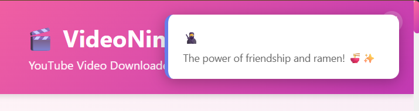
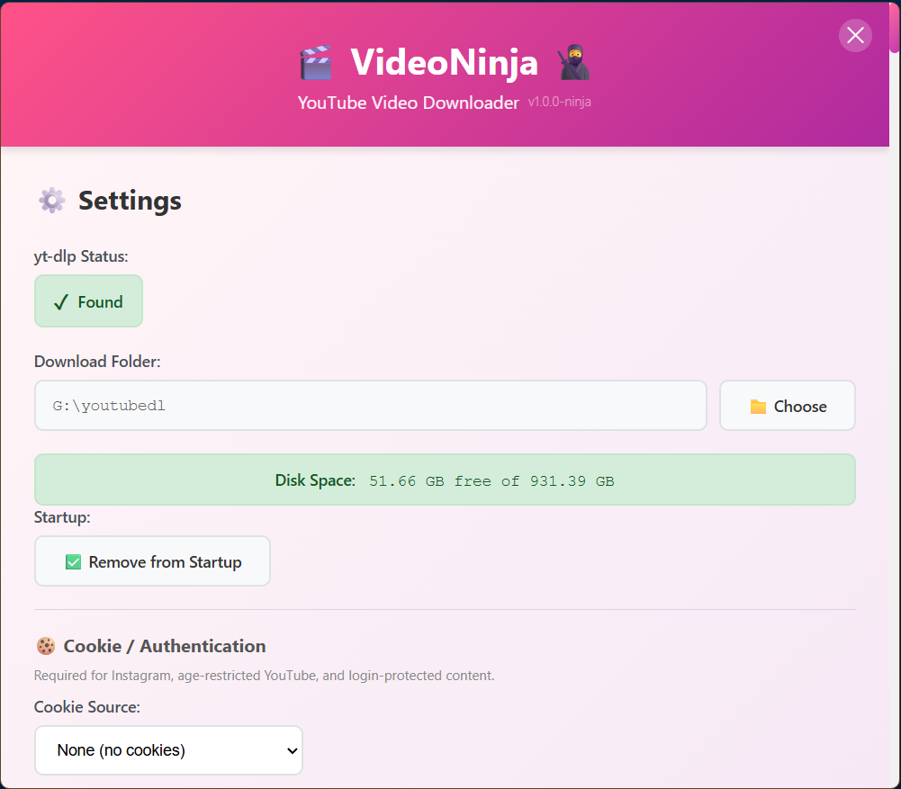
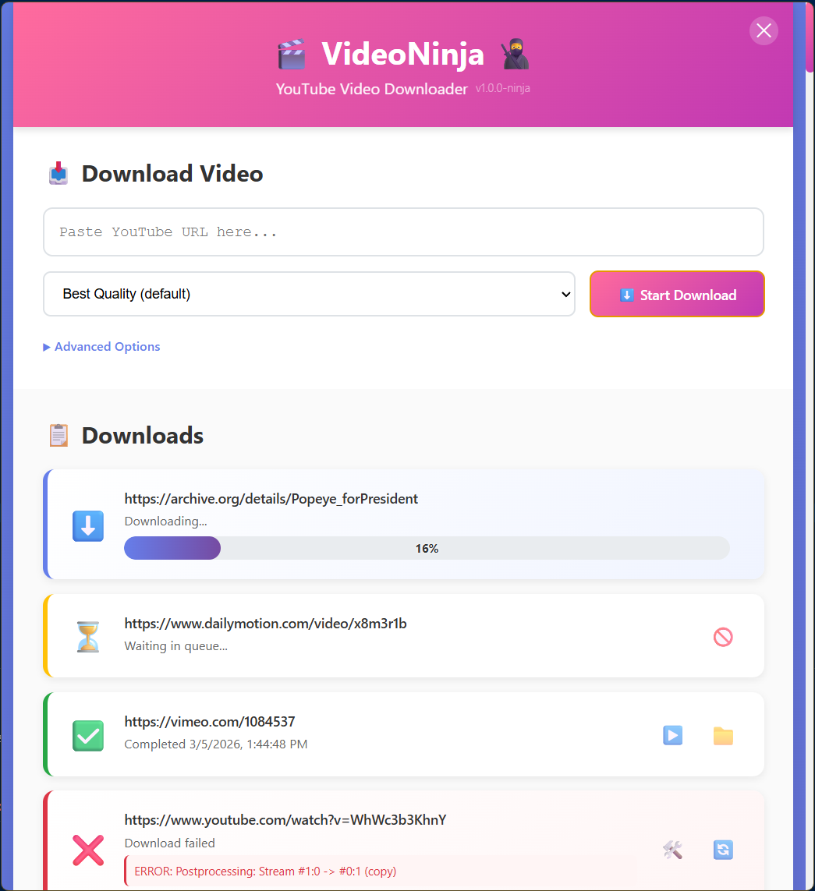

# 🎬 VideoNinja

[](https://github.com/miikkij/VideoNinja/actions/workflows/ci.yml)
[](https://opensource.org/licenses/MIT)
[]()
[](CONTRIBUTING.md)

**VideoNinja** is a beautiful, user-friendly YouTube video downloader built with Electron. It uses **yt-dlp** to download videos in various qualities with an intuitive interface and smart queue management.

<p align="center">
  
</p>
<p align="center">
  
  
</p>

## ✨ Features

- 🎯 **Simple & Intuitive** - Clean, colorful interface that's easy to use
- 📥 **Queue Management** - Download multiple videos, one at a time
- 🎨 **Quality Selection** - Choose from 4K, 1080p, 720p, or audio-only
- 💾 **Smart Storage** - Monitors disk space and warns when running low
- 🔔 **Tray Notifications** - Flashing tray icon when downloads complete
- 📂 **Easy Access** - Open videos or show them in folder with one click
- 💪 **Auto-Resume** - Automatically continues incomplete downloads on restart
- 🎯 **Persistent** - Remembers your settings and download history

## 🚀 Getting Started

### Prerequisites

VideoNinja requires two external tools:

| Tool | Purpose | Required |
|------|---------|----------|
| [yt-dlp](https://github.com/yt-dlp/yt-dlp) | Downloads videos from YouTube and other sites | **Yes** |
| [ffmpeg](https://ffmpeg.org/) | Merges video + audio streams for high-quality downloads | **Recommended** |

> Without ffmpeg, downloads may fail when the best quality requires merging separate video and audio streams.

#### Windows

**Option A — Chocolatey (recommended):**

```powershell
choco install yt-dlp ffmpeg -y
```

**Option B — Manual install:**

1. Download `yt-dlp.exe` from [yt-dlp releases](https://github.com/yt-dlp/yt-dlp/releases)
2. Download ffmpeg from [gyan.dev](https://www.gyan.dev/ffmpeg/builds/) (get the **essentials** build)
3. Place both executables in one of:
   - The same folder as VideoNinja
   - `C:\Program Files\yt-dlp\`
   - Any folder in your system PATH

**Keeping tools up to date:**

```powershell
yt-dlp -U
choco upgrade ffmpeg -y
```

#### macOS

```bash
brew install yt-dlp ffmpeg
```

### Running from Source

```bash
# Install dependencies
pnpm install

# Start the app
pnpm start
```

### Building Installers

```bash
# Build for Windows
pnpm run build:win

# Build for macOS
pnpm run build:mac
```

## 🎯 How to Use

1. **Launch VideoNinja** - The app will check for yt-dlp
2. **Configure** - Choose where to save your downloads
3. **Download** - Paste a YouTube URL, select quality, and click download
4. **Track** - Monitor progress in the downloads list
5. **Enjoy** - Click to open videos when complete!

## 📋 Features in Detail

### Download Queue
- Add multiple videos to the queue
- Videos download one at a time
- Queue persists across app restarts
- Resume interrupted downloads automatically

### Quality Options
- **Best Quality** (default) - Highest available quality
- **4K (2160p)** - Ultra HD
- **1440p** - Quad HD
- **1080p** - Full HD
- **720p** - HD
- **480p** - SD
- **Audio Only** - Extract audio track

### Disk Space Monitoring
- Real-time disk space display
- Warning when < 5GB free
- Critical alert when < 1GB free

### System Tray Integration
- Minimize to tray
- Flashing icon when downloads complete
- Quick access menu

## 🛠️ Technology Stack

- **Electron** - Cross-platform desktop framework
- **yt-dlp** - YouTube download engine
- **electron-store** - Persistent settings storage
- **Node.js** - Backend runtime

## 📁 Project Structure

```
VideoNinja/
├── src/
│   ├── main/
│   │   ├── index.js          # Main process
│   │   ├── ytdlp.js           # yt-dlp integration
│   │   └── downloadQueue.js   # Queue management
│   ├── renderer/
│   │   ├── index.html         # UI layout
│   │   ├── app.js             # UI logic
│   │   └── styles.css         # Styling
│   └── assets/
│       └── icons/             # App icons
├── package.json
└── README.md
```

## 🤝 Contributing

Contributions are welcome! Please read the [Contributing Guide](CONTRIBUTING.md) before submitting a pull request.

## 📄 License

This project is licensed under the MIT License — see the [LICENSE](LICENSE) file for details.

## ⚠️ Disclaimer

**VideoNinja is intended for downloading videos you have the legal right to download.** Users are solely responsible for ensuring their use of this tool complies with applicable laws, including copyright law and the terms of service of any platform they access. The developers of VideoNinja assume no liability for misuse.

---

**Made with ❤️ and Electron**
