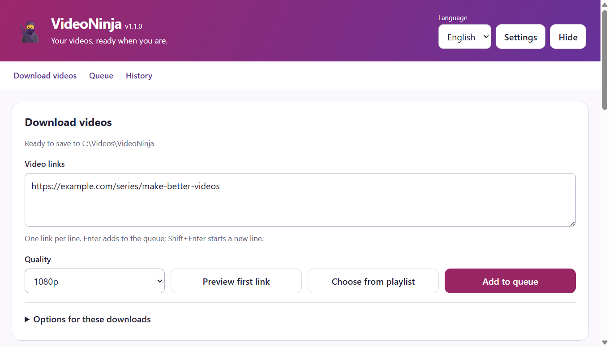
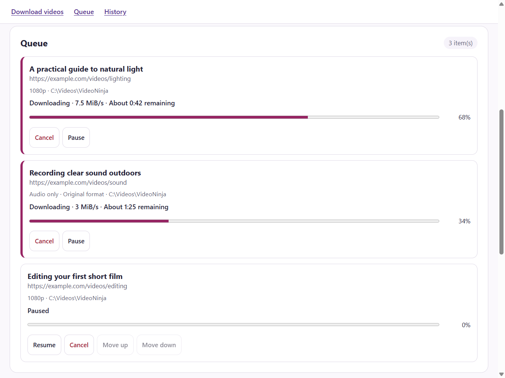
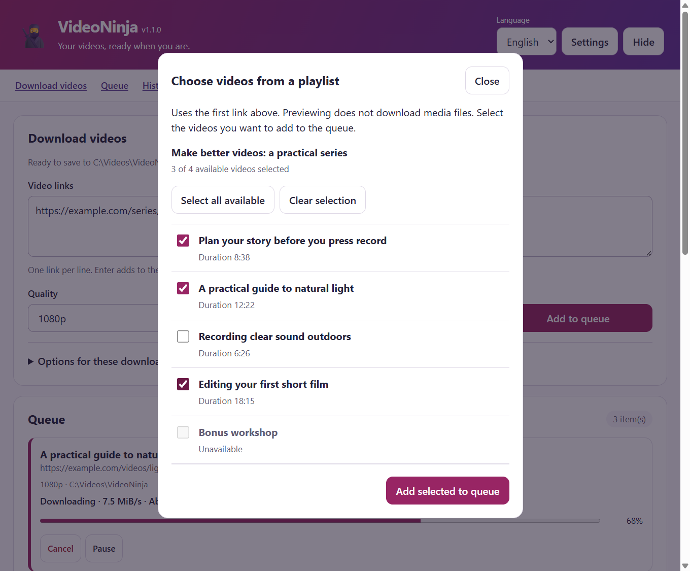
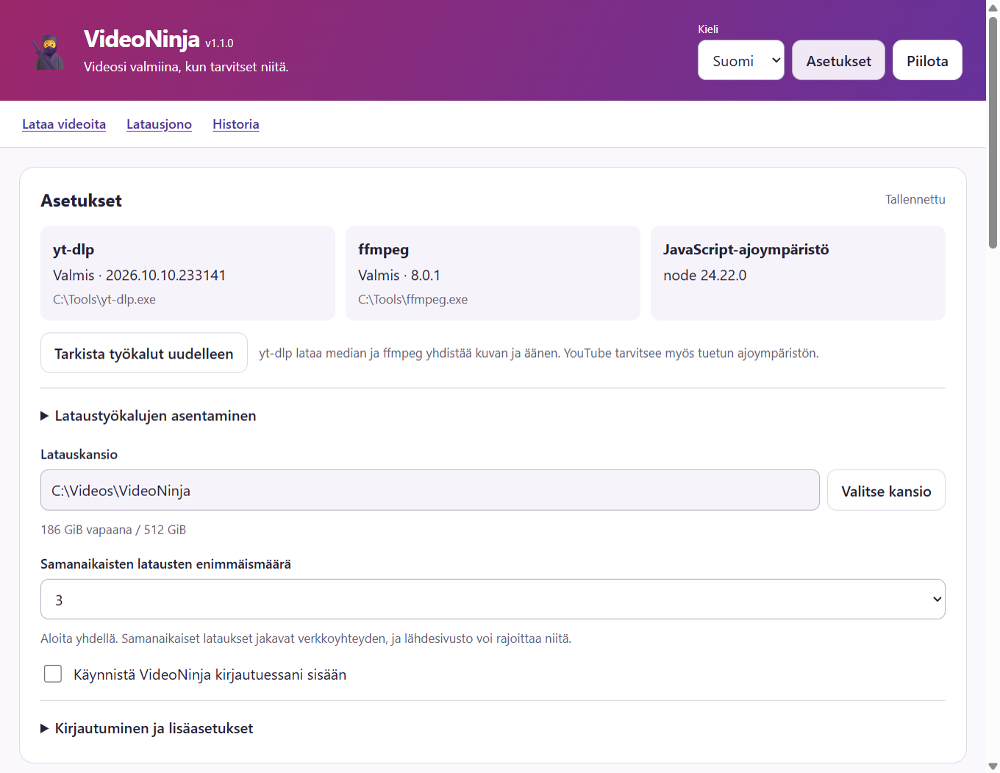

# VideoNinja

[](https://github.com/miikkij/VideoNinja/actions/workflows/ci.yml)
[](LICENSE)

VideoNinja is a desktop download manager for Windows, macOS and Linux.
Choose a folder, paste video links and follow the queue in English or Finnish.
[yt-dlp](https://github.com/yt-dlp/yt-dlp) handles downloads; your settings and history
stay on your computer.

This README describes the **1.1.0 source**. Check [Releases](https://github.com/miikkij/VideoNinja/releases)
for published binaries; a source version bump does not publish a release.

## Screenshots

The actual VideoNinja 1.1.0 interface on Windows, shown with sample data.
Click an image to open it at full size.

**Paste links, choose a quality and start downloading.**

[](docs/screenshots/overview-en.png)

<details>
<summary>Parallel downloads and queue controls</summary>

Follow each download's progress, speed and remaining time. Pause, resume or cancel
individual jobs while other downloads continue.

[](docs/screenshots/queue-en.png)

</details>

<details>
<summary>Choose individual videos from a playlist</summary>

Inspect the playlist before adding jobs. Select only the videos you want;
unavailable entries stay visible and cannot be selected.

[](docs/screenshots/playlist-en.png)

</details>

<details>
<summary>Suomenkieliset asetukset / Finnish settings</summary>

Switch between English and Finnish, check the download tools, choose a folder and
set the maximum number of simultaneous downloads.

[](docs/screenshots/settings-fi.png)

</details>

## Start here

- [Quick start](QUICK_START.md) / [Pikaohje suomeksi](QUICK_START.fi.md)
- [Troubleshooting](docs/TROUBLESHOOTING.md)
- [Development and packaging](CONTRIBUTING.md)
- [Architecture](docs/ARCHITECTURE.md)
- [Analysis, implementation and verification](docs/DEVELOPMENT_PLAN.md), in Finnish
- [Security and local data](SECURITY.md)

## Features

- English and Finnish interface, selectable in the header and saved between launches.
- Paste up to 100 HTTP(S) links at once, one per line. Enter submits; Shift+Enter adds a line.
- Choose 1–5 simultaneous downloads, with pause, resume, cancellation and queue reordering.
- Preview a playlist and select which of its first 500 entries to add.
- Best available, 2160p, 1440p, 1080p, 720p and 480p quality limits.
- Audio-only download in the original format or conversion to MP3, M4A, Opus or WAV.
- Optional metadata preview before downloading.
- Download and merge progress, speed, remaining time and real disk-space status.
- Searchable history, retry with revised options, export and confirmed clearing.
- Open a verified completed media file or reveal it in its folder.
- Optional cookies, start at login and tray operation.
- Keyboard controls, persistent errors, reduced-motion support and a responsive layout.

The queue holds up to 500 jobs and history keeps the latest 100 entries.
Paused jobs remain paused after restart; interrupted active jobs return to the queue.
Resume depends on the source server and yt-dlp's continuation support.
The default is one simultaneous download. Change **Maximum simultaneous downloads**
in Settings; reducing it lets active jobs finish before enforcing the lower limit.
Duplicate URLs in one submitted batch are added once. Repeated jobs for the same
URL and destination run sequentially even when other downloads run in parallel.

Use **Choose from playlist** to inspect the first pasted link, select available
videos and choose **Add selected to queue**. Previewing fetches metadata without
downloading media files or adding jobs. Unavailable entries cannot be selected.
The preview expires after 15 minutes and shows a notice when the playlist extends
beyond the first 500 entries. Ordinary **Add to queue** never expands a whole playlist.

## Download tools

Install these separately; VideoNinja does not bundle or silently install them.

| Tool                                                                    | Purpose                                                    |
| ----------------------------------------------------------------------- | ---------------------------------------------------------- |
| [yt-dlp](https://github.com/yt-dlp/yt-dlp#installation)                 | Required download engine. Keep it current as sites change. |
| [ffmpeg and ffprobe](https://ffmpeg.org/download.html)                  | Merge video/audio streams and convert audio.               |
| [JavaScript runtime and EJS](https://github.com/yt-dlp/yt-dlp/wiki/EJS) | Required for full YouTube support.                         |

Tools are discovered beside the executable, on PATH and in common platform
installation folders. Settings shows yt-dlp and ffmpeg paths and versions,
plus detected runtime versions.
Automatic runtime selection prefers Deno 2.3+ and then Node.js 22+; QuickJS is also
supported. Electron's internal Node runtime is not a standalone yt-dlp runtime.
A successful version check does not verify that matching EJS scripts are installed.

After changing tools, choose **Check tools again**. Restart VideoNinja if its
inherited PATH needs to change.

## Run from source

Use Node.js **24.22.0** from [.nvmrc](.nvmrc) and pnpm **10.20.0**.

```sh
git clone https://github.com/miikkij/VideoNinja.git
cd VideoNinja
npm install --global pnpm@10.20.0
pnpm install --frozen-lockfile
pnpm check
pnpm start
```

First launch opens Settings. Select a download folder, check the tools, then paste
a link and choose **Add to queue**. Use **Settings** or F3 to reopen preferences.
Closing the window hides it when a tray is available; **Quit** in the tray menu
stops the app safely. Without a tray, closing exits.

## Packages and checks

| Platform | Outputs                         | Current build architecture |
| -------- | ------------------------------- | -------------------------- |
| Windows  | NSIS installer and portable EXE | x64                        |
| macOS    | DMG and ZIP                     | Native runner architecture |
| Linux    | AppImage and Debian package     | Native runner architecture |

Build on the target operating system with `pnpm build:win`, `pnpm build:mac`
or `pnpm build:linux`. Builds never publish automatically.
The CI matrix checks source and packaged applications on all three systems.
Version and artifact checks prevent mismatched releases. A tag-triggered release
workflow creates a draft for review; signing and notarization are not configured.

Electron 44 requires macOS 13 or newer and 64-bit platforms. The CI matrix covers
current hosted operating systems; it does not establish compatibility with every
older distribution or desktop environment.

```sh
pnpm check
pnpm run audit
pnpm test:smoke
pnpm test:media
```

The Electron smoke test uses an isolated temporary profile. The media smoke test
requires yt-dlp and ffmpeg/ffprobe, creates its own media and downloads only from
a temporary localhost server. See [Contributing](CONTRIBUTING.md) for Linux display
and sandbox requirements, packaging checks and release responsibilities.

## Privacy and limitations

URLs, paths and selected download options are stored locally in an unencrypted
profile. Keep cookie files private. Clearing history removes history records,
not downloaded files. Export omits local paths, authentication options and errors,
and strips URL credentials, queries and fragments; review titles and URLs before sharing.

Additional yt-dlp options use a small allowlist. Arbitrary commands, plugins,
configuration files and automatic remote-component fetching are disabled.
Audio-only requires an available audio format and does not fall back to a video.
Third-party site changes, login restrictions and DRM can prevent downloading.
Download only content you have permission to save.

For known environmental restrictions and the remaining build-only dependency
advisory, see [Security](SECURITY.md) and the [verification record](docs/DEVELOPMENT_PLAN.md).
