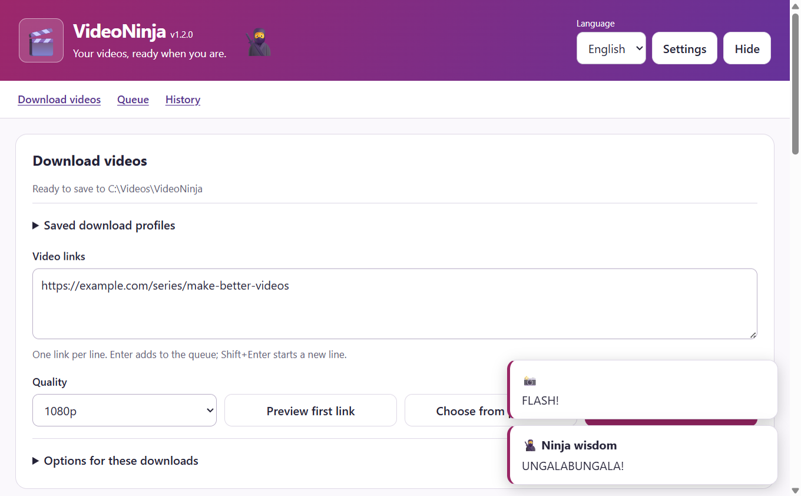
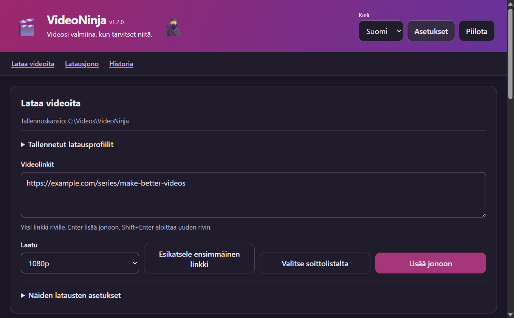

# VideoNinja

[](https://github.com/miikkij/VideoNinja/actions/workflows/ci.yml)
[](LICENSE)

VideoNinja is a desktop download manager for Windows, macOS and Linux.
Choose a folder, paste video links and follow the queue in English or Finnish.
[yt-dlp](https://github.com/yt-dlp/yt-dlp) handles downloads; your settings and history
stay on your computer.

**The source tree is the unreleased 1.2.0 development version.** The downloads below
are the published 1.1.0 release. The feature descriptions and guides describe
1.2 development; its new controls are not present in the 1.1 installers.

## Download VideoNinja 1.1.0

| Platform                          | Installer                                                                                                      | Alternative                                                                                                       |
| --------------------------------- | -------------------------------------------------------------------------------------------------------------- | ----------------------------------------------------------------------------------------------------------------- |
| Windows x64                       | [Windows installer](https://github.com/miikkij/VideoNinja/releases/download/v1.1.0/VideoNinja.Setup.1.1.0.exe) | [Portable EXE](https://github.com/miikkij/VideoNinja/releases/download/v1.1.0/VideoNinja.1.1.0.exe)               |
| macOS 13+ · Apple Silicon (ARM64) | [macOS DMG](https://github.com/miikkij/VideoNinja/releases/download/v1.1.0/VideoNinja-1.1.0-arm64.dmg)         | [ZIP](https://github.com/miikkij/VideoNinja/releases/download/v1.1.0/VideoNinja-1.1.0-arm64-mac.zip)              |
| Linux x64                         | [AppImage](https://github.com/miikkij/VideoNinja/releases/download/v1.1.0/VideoNinja-1.1.0.AppImage)           | [Debian / Ubuntu DEB](https://github.com/miikkij/VideoNinja/releases/download/v1.1.0/video-ninja_1.1.0_amd64.deb) |

[Release notes](https://github.com/miikkij/VideoNinja/releases/tag/v1.1.0) ·
[SHA-256 checksums](https://github.com/miikkij/VideoNinja/releases/download/v1.1.0/SHA256SUMS.txt)

Packages are unsigned, and the macOS app is not notarized. This release does not
include an Intel Mac build. Install the [download tools](#download-tools) separately,
then follow the released version's
[quick start](https://github.com/miikkij/VideoNinja/blob/v1.1.0/QUICK_START.md) /
[pikaohje](https://github.com/miikkij/VideoNinja/blob/v1.1.0/QUICK_START.fi.md).

## Screenshots

The actual VideoNinja 1.2 development interface on Windows, shown with isolated sample data.
Click an image to open it at full size.

**Paste links, choose a quality and start downloading.**

[](docs/screenshots/overview-en.png)

<details>
<summary>Ninja wisdom and a camera flash</summary>

Click the ninja for a random saying or the camera for a brief flash. The original
210 English quotes are back, with Finnish counterparts and playful queue/download
messages. These short messages leave actionable errors visible.

[](docs/screenshots/personality-en.png)

</details>

<details>
<summary>Parallel downloads and queue controls</summary>

Follow each download's progress, speed and remaining time. Pause, resume or cancel
individual jobs while other downloads continue.

[](docs/screenshots/queue-en.png)

</details>

<details>
<summary>Choose individual videos from a playlist</summary>

Inspect the playlist before adding jobs. Select only the videos you want;
unavailable entries stay visible and cannot be selected.

[](docs/screenshots/playlist-en.png)

</details>

<details>
<summary>Suomenkieliset asetukset / Finnish settings</summary>

Switch between English and Finnish, check the download tools, choose a folder and
set the maximum number of simultaneous downloads.

[](docs/screenshots/settings-fi.png)

</details>

<details>
<summary>Dark theme / Tumma teema suomeksi</summary>

[](docs/screenshots/overview-dark-fi.png)

</details>

## Start here

- [Quick start](QUICK_START.md) / [Pikaohje suomeksi](QUICK_START.fi.md)
- [Troubleshooting](docs/TROUBLESHOOTING.md)
- [Service requirements and download recovery](docs/USER_GUIDE.md)
- [Development and packaging](CONTRIBUTING.md)
- [Architecture](docs/ARCHITECTURE.md)
- [Analysis, implementation and verification](docs/DEVELOPMENT_PLAN.md), in Finnish
- [Security and local data](SECURITY.md)

## Features

- English/Finnish interface, keyboard controls and light, dark or system theme.
- Ninja wisdom, a camera flash and playful download messages, with all 210 original
  English quotes and matching Finnish translations.
- Up to 100 links per ordinary batch, 500 queued jobs and 1–5 concurrent downloads.
- Individual and selected-job pause, resume, cancellation and reordering.
- Playlist previews with search, range selection and pages beyond the first 500 entries.
- Quality presets, actual source formats/codecs/resolutions/size estimates and audio conversion.
- Named profiles, subtitle languages, automatic captions and per-job speed limits.
- Total speed limit, local-time download windows, bounded automatic retries and stall detection.
- Disk-space reservations based on available size estimates and a configurable free-space floor.
- Source-ID duplicate archive, searchable history, selective deletion and age-based retention.
- Private jobs and optional OS-backed encryption of saved settings and activity.
- Optional grouped desktop notifications and verified completed-file actions.
- Managed download-tool installation/update, EJS diagnostics and application update checks.

The queue holds up to 500 jobs and history keeps the latest 100 entries.
Paused jobs remain paused after restart; interrupted active jobs return to the queue.
Private jobs are excluded from saved state and history. Resume depends on the
source server and yt-dlp's continuation support. The default concurrency is one.
Lowering it lets active jobs finish when no total speed limit is enabled. Changing
an active total speed limit, or concurrency while that limit is enabled, restarts
transfers with preserved partial files to apply the new allocation.

Use **Choose from playlist** to inspect the first pasted link, select available
videos and choose **Add selected to queue**. Previewing fetches metadata without
downloading media files or adding jobs. Each page contains at most 500 entries;
add or clear its selection before changing pages. Previews expire after 15 minutes.
Ordinary **Add to queue** never expands a whole playlist. Duplicate URLs in a batch
are added once; jobs for the same URL and folder run sequentially.

See the [20-item implementation record](docs/DEVELOPMENT_PLAN.md) for the exact
scope, defaults and verification limits.

## Download tools

Download tools are separate executables. In 1.2 development, Settings offers
explicit installation/update and setup instructions; nothing installs silently.
The released 1.1 app requires manual installation through the links below.

| Tool                                                                    | Purpose                                                    |
| ----------------------------------------------------------------------- | ---------------------------------------------------------- |
| [yt-dlp](https://github.com/yt-dlp/yt-dlp#installation)                 | Required download engine. Keep it current as sites change. |
| [ffmpeg and ffprobe](https://ffmpeg.org/download.html)                  | Merge video/audio streams and convert audio.               |
| [JavaScript runtime and EJS](https://github.com/yt-dlp/yt-dlp/wiki/EJS) | Required for full YouTube support.                         |

Managed yt-dlp and Deno installation is supported on Windows, Linux and macOS
x64/ARM64. Managed ffmpeg/ffprobe installation supports Windows and Linux;
macOS uses guided Homebrew installation. Downloads use official upstream release
sources and their SHA-256 manifests, then stage and verify executables before
replacing the previous managed version. Tools installed by another method remain
under that method's control.

Choose **Stable** or **Nightly** in the yt-dlp card before updating. Upstream
recommends Nightly for current site fixes. VideoNinja warns when the detected
yt-dlp build is more than 90 days old. Updating the app itself does not update
an old globally installed yt-dlp: install/update the managed engine in Settings.
Manually paused jobs can stay in the queue during a tool update; wait until their
download processes have stopped. See the [service guide](docs/USER_GUIDE.md) for
Instagram access errors, browser cookies and YouTube requirements.

Managed tools under the app's user-data folder take discovery priority, followed
by executable/PATH and common installation locations. Settings shows detected
paths and versions. `VIDEONINJA_TOOLS_DIR` selects an isolated managed directory
for development and testing.
Automatic runtime selection prefers Deno 2.3+ and then Node.js 22+; QuickJS is also
supported. Electron's internal Node runtime is not a standalone yt-dlp runtime.
**Check YouTube support** inspects the installed EJS package/runtime and, when
available, compares EJS with the exact yt-dlp revision's expected version. It is
not a live YouTube challenge test or a guarantee that a video is accessible.

After changing tools, choose **Check tools again**. Restart VideoNinja if its
inherited PATH needs to change.

## Run from source

Use Node.js **24.22.0** from [.nvmrc](.nvmrc) and pnpm **10.20.0**.

```sh
git clone https://github.com/miikkij/VideoNinja.git
cd VideoNinja
npm install --global pnpm@10.20.0
pnpm install --frozen-lockfile
pnpm check
pnpm start
```

First launch opens Settings. Select a download folder, check the tools, then paste
a link and choose **Add to queue**. Use **Settings** or F3 to reopen preferences.
Closing the window hides it when a tray is available; **Quit** in the tray menu
stops the app safely. Without a tray, closing exits.

## Packages and checks

| Platform | Outputs                         | 1.1.0 release architecture |
| -------- | ------------------------------- | -------------------------- |
| Windows  | NSIS installer and portable EXE | x64                        |
| macOS    | DMG and ZIP                     | ARM64 (Apple Silicon)      |
| Linux    | AppImage and Debian package     | x64 / amd64                |

Build on the target operating system with `pnpm build:win`, `pnpm build:mac`
or `pnpm build:linux`. Builds never publish automatically.
The CI matrix checks source and packaged applications on all three systems.
Version and artifact checks prevent mismatched releases. A tag-triggered release
workflow creates a draft for review. Signing/notarization and update manifests
are supported by the build scripts, but signing credentials are not configured
and no signed release has been published. See the exact
[release prerequisites](CONTRIBUTING.md#signing-and-application-updates).

Electron 44 requires macOS 13 or newer and 64-bit platforms. The CI matrix covers
current hosted operating systems; it does not establish compatibility with every
older distribution or desktop environment.

```sh
pnpm check
pnpm run audit
pnpm test:smoke
pnpm test:features
pnpm test:media
```

The Electron smoke test uses an isolated temporary profile. The media smoke test
requires yt-dlp and ffmpeg/ffprobe, creates its own media and downloads only from
a temporary localhost server. See [Contributing](CONTRIBUTING.md) for Linux display
and sandbox requirements, packaging checks and release responsibilities.

## Privacy and limitations

Saved settings/activity are plaintext by default. Optional OS-backed encryption
protects that saved payload when the OS provides a supported secret store; it
does not encrypt media, cookies or old backups. Private jobs are kept only in
memory and disappear on exit. History deletion never removes media files.
Export omits local paths, authentication options and errors, and strips URL
credentials, queries and fragments; review titles and URLs before sharing.

Startup update checks contact GitHub and can be disabled in Settings. Application
download and installation require explicit actions. Unsigned Windows/macOS builds,
portable Windows, Debian packages and source runs use the release page instead
of automatic installation. The public 1.1 release has no application updater.

Additional yt-dlp options use a small allowlist. Arbitrary commands, plugins,
configuration files and automatic remote-component fetching are disabled.
Audio-only requires an available audio format and does not fall back to a video.
Third-party site changes, login restrictions and DRM can prevent downloading.
Completion checks a nonempty final file and, when ffprobe is present, its container
and media streams. Without ffprobe the result explicitly reports size-only
verification. Neither check guarantees every frame can be decoded.
Download only content you have permission to save.

For known environmental restrictions and the remaining build-only dependency
advisory, see [Security](SECURITY.md) and the [verification record](docs/DEVELOPMENT_PLAN.md).
