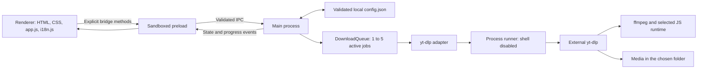
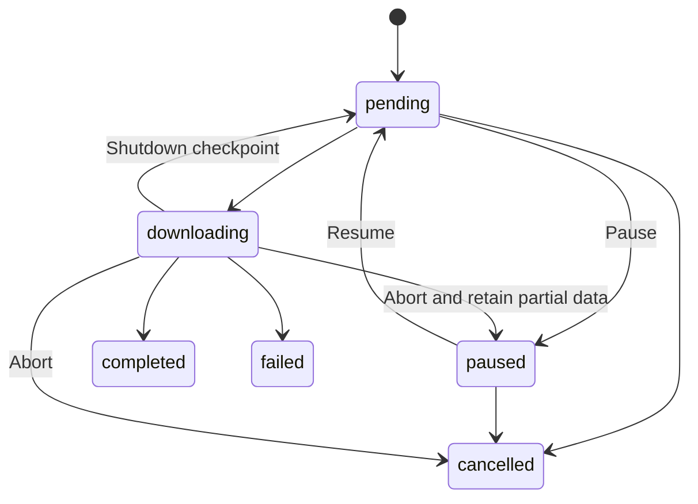

# Architecture

This document describes the version 1.1 implementation. Release validation and
remaining work are tracked in the [development plan](DEVELOPMENT_PLAN.md).

## Runtime and module boundaries

There is no application backend, remote database or frontend build step. A
restricted custom protocol serves packaged renderer resources. Downloads and
video/playlist metadata previews access source services through external yt-dlp.

| Module                                                   | Responsibility                                                                                          |
| -------------------------------------------------------- | ------------------------------------------------------------------------------------------------------- |
| `src/main/index.js`                                      | Application/window/tray lifecycle, resource protocol, initial state, tool/disk status and shutdown.     |
| `src/main/ipc.js`                                        | Sender and payload validation, native dialogs, explicit commands and safe file actions.                 |
| `src/preload.js`                                         | Frozen `window.videoNinja` API and removable event subscriptions.                                       |
| `src/main/downloadOptions.js`                            | HTTP(S) URL validation, quality presets and allowlisted option normalization.                           |
| `src/main/downloadQueue.js`                              | Stable-ID queue state machine, cancellation, pause/resume, retries and history.                         |
| `src/main/persistence.js`                                | Schema migration, bounded validation, error redaction, corrupt-file quarantine and durable checkpoints. |
| `src/main/tools.js`                                      | External executable discovery and bounded version probes.                                               |
| `src/main/processRunner.js`                              | Shell-free processes, UTF-8 line framing, bounded output and process-tree cancellation.                 |
| `src/main/ytdlp.js`                                      | yt-dlp arguments/protocol, metadata, final file verification and disk-space measurement.                |
| `src/main/startup.js`                                    | Native login items or owned Linux XDG autostart entry.                                                  |
| `src/renderer/app.js`, `i18n.js`, `styles.css`           | Text-only DOM updates, queue/history interactions, English/Finnish strings and layout.                  |
| `tests/`, `scripts/*smoke.mjs`, `scripts/smoke-test.mjs` | Unit/DOM coverage, real media pipeline and Electron application checks.                                 |

## Startup and shutdown

The main process selects the user-data directory, checks the configuration before
opening `electron-store`, validates saved settings/queue/window bounds and creates
the application window. `VIDEONINJA_USER_DATA` can select an absolute profile
directory for isolated testing. A single-instance lock brings the existing window
forward when another instance is launched.

The renderer explicitly requests its initial state through the preload bridge.
Reloading therefore receives current state without restoring the queue again.
Queue restoration happens once; pending work can resume, while paused work stays
paused. Tool probes run asynchronously and **Check Again** performs fresh probes.
Disk space is refreshed when the folder changes and every 30 seconds.

Closing the window hides it when a tray exists. Without a tray, normal window
closing can quit the application. Quit stops polling, aborts outstanding metadata
and playlist previews plus every active download, waits for all child processes
to settle, and checkpoints the queue before exit. Interrupted active jobs are saved as pending;
partial media is retained for a later continuation attempt.

Startup registration is available only for packaged applications. Windows/macOS
use Electron's native login-item APIs. Linux uses
`$XDG_CONFIG_HOME/autostart/videoninja.desktop` (or
`~/.config/autostart/videoninja.desktop`) with a quoted executable path and an
ownership marker. The code refuses to replace another application's entry.
AppImage registration uses its persistent AppImage path rather than a temporary
mount path; actual autostart behavior also depends on the desktop environment.

## Queue state and events

New jobs receive UUIDs. Jobs contain the validated URL, absolute destination,
normalized options, timestamps, progress, metadata and, after success, a verified
final file path. All actions address stable job IDs.

`settings.maxConcurrent` selects 1–5 active downloaders, defaulting to 1. Increasing
the limit immediately fills available slots. Lowering it does not abort active
jobs; new jobs wait until the active count is below the new limit. Startup applies
the saved limit before scheduling restored jobs.

An active-job map holds a distinct `AbortController` and promise for each job.
The adapter receives `downloadVideo(url, outputPath, options, callback, { signal })`.
Cancellation records one terminal transition and reserves that slot until the
process settles; a late completion cannot overwrite it. Other active jobs keep
running. Pause keeps the same job and its partial files, and resume cannot overlap
the old attempt. A retry of a failed/cancelled history entry creates a new job.
Pending and paused jobs can be reordered around active jobs.

The scheduler serializes jobs with the same URL and resolved output directory,
ignoring the URL fragment but retaining its query. Windows output paths are
case-folded for that key. A cancelling/pausing child retains the key until it exits;
unrelated URLs can use other slots. The adapter also reserves canonical
directory/normalized-URL pairs within this application instance. These locks do
not coordinate with another application writing to the same folder.

`getQueueState()` exposes `activeIds` and `maxConcurrent`. Aborting children remain
in `activeIds` until settled. The legacy `currentDownload` is the first active job,
and `isProcessing` means at least one active attempt remains. To restore without
starting at the default limit, use `loadState(state, { start: false })`,
`setConcurrency(limit, { start: false })`, then `processNext()`.

The durable status is `pending`, `downloading`, `paused`, `completed`, `failed`
or `cancelled`. Progress also carries a phase such as `preparing`, `downloading`
or `merging`, plus percent, speed and ETA from the adapter.

The queue is capped at 500 jobs and history at 100 entries. Ordinary batch input
accepts at most 100 URLs. A playlist selection may supply up to 500 entries within
the same remaining capacity. `addBatch(urls, outputPath, options)` validates and
deduplicates the complete batch before one append and notification, then schedules
available slots. Its return value contains the accepted job IDs. History can be
searched, cleared after native confirmation, or exported through a save dialog.
Clearing history does not remove media. Export strips credentials, URL query and
fragment, local paths, errors and authentication/network options; titles and URL
paths can still be private.

`queue-updated` reports durable changes. `download-progress` reports transient
progress separately, so ordinary progress updates do not write the complete
configuration to disk. State transitions checkpoint the latest snapshot,
including any metadata received since the previous checkpoint.

## Playlist inspection and selection

Playlist inspection is explicit and separate from adding individual links. The
renderer sends the first input URL to `previewPlaylist`; yt-dlp uses flat playlist
metadata mode with media downloading disabled. It fetches at most 501 entries to
detect truncation, exposes only the first 500, and reports `hasMore` for the UI
notice. Entries contain bounded identity, title, URL, duration and availability
fields. Nested playlists, private/unavailable entries and invalid URLs cannot be
selected. Raw extractor JSON does not cross the bridge.

The main process keeps one preview in memory with a generated `previewId` and a
15-minute expiry. A newer preview, cancellation, successful enqueue or shutdown
invalidates it. `addPlaylistSelection` accepts that ID and entry indices; main
resolves the URLs from its cache, revalidates options/folder/capacity and calls
the atomic batch API. Previewing alone never adds jobs. The dialog starts with
no selections, disables unavailable entries and preserves selections if enqueue
fails. Preview data is not restored after an application restart.

Each selected URL becomes a normal independently controlled job. Actual downloads
and single-video previews pass `--no-playlist --playlist-items 1`, so a queued
playlist URL cannot unexpectedly expand into every item.

## Persistence and recovery

`electron-store` writes `config.json` under `app.getPath('userData')`. Source and
packaged runs may have different user-data paths. Media lives separately in the
chosen destination folder.

| Key             | Saved data                                                                                    |
| --------------- | --------------------------------------------------------------------------------------------- |
| `schemaVersion` | Configuration schema version, currently 1.                                                    |
| `settings`      | Versioned language, folder, default quality and validated authentication/runtime preferences. |
| `queueState`    | Versioned queue and bounded history.                                                          |
| `windowBounds`  | Sanitized window geometry; off-screen positions are not restored.                             |

Unversioned legacy data is migrated. Invalid options, duplicate IDs, malformed
entries and unsupported future queue schemas are rejected with recovery warnings.
Interrupted downloading/merging states become pending. The additive
`settings.maxConcurrent` field accepts only integers 1–5; missing/invalid values
restore as 1. Saved error strings are
redacted and bounded to 2,000 characters.

Before store initialization, malformed JSON or a non-object root is moved to a
sibling `config.json.corrupt-<timestamp>-<uuid>` file. Startup then uses defaults.
Oversized configuration files are also rejected. If the file cannot be read or
quarantined safely, startup fails instead of silently overwriting it. These
backups may contain private data and are not automatically removed.

Configuration is local plaintext, not encrypted secret storage. Authentication
preferences and original URLs may be needed for retry, so the private store is
more detailed than a history export. See [Security](../SECURITY.md).

## Renderer and IPC boundary

The window enables sandboxing, context isolation and web security, with Node
integration disabled. Its Content Security Policy limits scripts/styles to local
resources and denies renderer network connections. The `videoninja://app/`
protocol exposes an explicit resource map, not arbitrary files. Navigation,
new windows and webviews are denied.

The renderer receives named methods such as `addDownloads`, `previewPlaylist`,
`addPlaylistSelection`, `pauseDownload`, `retryDownload` and `openFile`; it receives
no generic IPC send/invoke capability.
Main-process handlers check the originating window, main frame, application URL
and command payload. Replies use `{ ok, data }` or a bounded public error object.
Untrusted titles, URLs and error text are rendered as text.

Directory and cookie-file selection use native dialogs. File actions accept a
completed download ID, resolve the stored path, check that it remains inside the
job's destination directory, and require a regular media file with an allowed
extension. External links are restricted to fixed help URLs. These checks limit
the bridge's authority; they do not sandbox external download tools or protect a
profile from another process running as the same user.

## Download adapter and external tools

Executable discovery checks application locations, absolute PATH entries and
platform-specific installation directories, including Linux paths. It does not
search an arbitrary working directory. Version probes have timeouts and launch
without a shell. Detected ffmpeg and JavaScript runtime paths are passed
explicitly to yt-dlp.

Automatic runtime choice prefers supported Deno, then Node.js, then QuickJS.
The application's compatibility checks require Deno 2.3+, Node.js 22+, or a
recognized supported QuickJS version. Electron's embedded JavaScript engine does
not substitute for an external runtime. Version probes do not establish that
yt-dlp's EJS scripts are installed or usable.

The adapter disables user yt-dlp configuration, plugin directories and remote
component downloads. URLs are HTTP(S) only, credentials in URLs are rejected and
the URL follows the argument terminator. Extra arguments are limited to a small
network/retry allowlist; arbitrary command, output-template and executable
options are rejected. Authentication failure does not silently retry without
cookies.

Machine-readable progress and metadata are decoded across process chunk
boundaries. Completion uses yt-dlp's `after_move` path, then verifies that the
file exists inside the destination. Filenames include the title, extractor/video
ID, quality/audio format and the first 16 hexadecimal SHA-256 characters of the
normalized input URL. The same URL/options retain a repeatable path; distinct URL
aliases and quality choices get separate names. This does not rename files saved
with older filename templates. Quality selectors enforce the requested height ceiling. Audio-only
selects an audio stream; optional conversion uses ffmpeg. Subprocess output and
errors are bounded. Cancellation terminates the process tree and waits for exit.

Disk usage comes from `fs.statfs` for the selected folder on all platforms. A
failed measurement is reported as unavailable. The UI warns below 5 GiB and marks
below 1 GiB critical; this is an advisory free-space check, not a prediction of
download size or a storage reservation.

## Packaging and verification

The package contains application source and production dependencies plus the
Electron runtime. yt-dlp, ffmpeg/ffprobe and JavaScript runtimes are external.
Windows builds NSIS/portable x64 packages, macOS DMG/ZIP, and Linux AppImage/deb.
There is no configured signing/notarization or automatic updater.

CI is configured to run checks, source smoke, full native packaging, packaged
smoke and artifact validation on all three operating systems. A further
GitHub-hosted-only check exercises the app from a Windows NSIS installation,
read-only macOS DMG mount or extracted Linux Debian package. The media smoke
uses real tools with generated local fixtures, including playlist inspection and
parallel URL aliases, and is a separate explicit check.
Workflow configuration is not proof of a passing run; see
[Contributing](../CONTRIBUTING.md) for commands and release validation.
