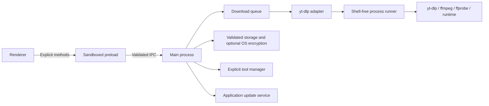

# Architecture

This describes **1.2.0 development**, not the published 1.1.0 packages. See the
[implementation record](DEVELOPMENT_PLAN.md) for verification and release boundaries.

## Runtime boundaries

There is no application server, remote database or frontend bundler. A restricted
`videoninja://app/` protocol serves local resources. Renderer Node integration is
disabled; context isolation, sandboxing and CSP are enabled. Navigation, webviews
and new windows are denied. Untrusted titles/errors enter the DOM as text.

| Module                                         | Responsibility                                                                                              |
| ---------------------------------------------- | ----------------------------------------------------------------------------------------------------------- |
| `src/main/index.js`                            | Window/tray lifecycle, initial state, service wiring and coordinated shutdown.                              |
| `src/main/ipc.js`                              | Window/frame and payload validation, dialogs, playlist cache, profiles, bulk actions and safe file actions. |
| `src/preload.js`                               | Frozen narrow bridge and removable event subscriptions.                                                     |
| `src/main/downloadOptions.js`                  | Canonical HTTP(S) URL and allowlisted option validation.                                                    |
| `src/main/downloadQueue.js`                    | Scheduling, concurrency, retries, reservations, archive, history and progress events.                       |
| `src/main/downloadErrors.js`                   | Bounded error classification and retry eligibility.                                                         |
| `src/main/persistence.js`                      | Settings/state migration, recovery and durable checkpoints.                                                 |
| `src/main/privateStore.js`, `storageLimits.js` | Atomic settings/activity storage, OS encryption and common read/write limits.                               |
| `src/main/tools.js`, `toolManager.js`          | Discovery, probes, EJS diagnosis, verified managed installs and guided setup.                               |
| `src/main/processRunner.js`                    | Bounded UTF-8 output, process-tree cancellation and shell-free execution.                                   |
| `src/main/ytdlp.js`                            | Arguments, projected metadata, paging, final-path/integrity checks and disk measurement.                    |
| `src/main/appUpdater.js`, `notifications.js`   | Explicit application updates and opt-in grouped notifications.                                              |
| `src/main/startup.js`                          | Native login items or an owned Linux XDG autostart entry.                                                   |
| `src/renderer/`                                | English/Finnish UI, themes, queue/history selection and accessible controls.                                |

## Startup and shutdown

The main process selects the profile, checks the config before opening
`electron-store`, decrypts where requested, sanitizes settings/queue/window bounds,
then restores the queue once with scheduling initially stopped. Settings are
applied before processing starts. Renderer reload requests current state instead
of restoring the queue again. A single-instance lock focuses the existing app.

`VIDEONINJA_USER_DATA` selects an isolated absolute profile directory;
`VIDEONINJA_TOOLS_DIR` selects an isolated managed-tool directory. Tool probes are
asynchronous and refreshable. Disk status refreshes on folder changes and every
30 seconds. Closing hides the window if a tray exists; otherwise it exits.

Quit aborts previews and active downloads, awaits their process cleanup and saves
eligible unfinished work as pending. Manually paused jobs stay paused. Private
jobs are excluded from saving. Partial media is retained. Start at login requires
a packaged app: Windows/macOS use native APIs; Linux uses an owned, quoted XDG
`videoninja.desktop` entry and the persistent AppImage path when applicable.

## Queue and resource scheduling

Jobs have UUIDs, validated URLs, absolute destinations, normalized options,
metadata and timestamps. Actions address stable IDs. The queue holds 500 jobs;
ordinary submissions contain at most 100 links. Batch insertion validates and
deduplicates before one durable mutation. History holds at most 100 terminal jobs.

`pending`, `downloading` and `paused` are live states; `completed`, `failed`,
`cancelled` and archive-derived `skipped` are terminal states. Pending phases
include waiting for retry, disk, schedule or a duplicate source. Every active job
has its own controller. Slots and URL/output reservations remain held until the
process promise settles, including cancellation/pause. Pending jobs can reorder.
`queue-updated` drives persistence; `download-progress` does not write the store.

Concurrency is 1–5, default 1. Same normalized URL/resolved output pairs serialize;
fragments are excluded from that identity, queries retained. Other URLs can fill
available slots. Without a global rate cap, reducing concurrency lets active jobs
finish. With a cap, changes restart transfers after all old allocations settle.
The positive total KiB/s limit is divided by configured slots, rounded down; an
individual lower cap still applies. Idle slots can leave bandwidth unused. The
structured cap is appended after raw allowlisted arguments and cannot be raised
by a pasted `--limit-rate` value.

Before download, metadata enables a source archive identity and size estimate.
The reservation is twice the known media size for video, three times for audio,
plus a configurable free-space floor (default 1024 MiB). Active reservations share
a filesystem identity when known; unknown volume identities are handled
conservatively. Insufficient known space waits and rechecks after 30 seconds.
Unknown sizes or free-space failures are warnings, not fabricated capacity or an
OS-level disk reservation. Other programs can consume space meanwhile.

Recoverable network/rate-limit/stall failures retry automatically, default two
retries, maximum five. The initial delay defaults to 15 seconds; exponential
backoff is capped at 15 minutes. Authentication, format and permanent source
failures need intervention. A watchdog watches real percentage/byte advancement
or phase changes, not repeated heartbeat messages. Defaults are 180 seconds for
downloading and 900 seconds for processing. Abort settlement precedes retry.

Optional local-time schedule windows include overnight ranges. At closing time,
active jobs pause with their partials; only schedule-paused jobs resume next
window. Manually paused jobs remain paused. Scheduling needs the app running and
does not wake the OS.

## Metadata, playlists and output

Metadata is a bounded projection: title, source ID/extractor, duration, extension,
size estimates and up to 200 sanitized format records. Formats expose concrete
IDs, codecs, dimensions, frame rate and sizes, never media URLs or HTTP headers.
Exact format selection accepts one concrete ID or a video plus audio ID. It is
validated against fresh source metadata before download. The adapter uses exact
`format_id` filters rather than treating an ID as a free-form yt-dlp expression.
Named profiles deliberately exclude exact IDs and authentication.

Playlist inspection accepts `{ start, pageSize, signal }`, with a one-based start
and at most 500 entries per page. One extra entry detects `hasMore`; returned
indexes remain absolute. The main-process preview cache expires after 15 minutes.
Selection refers to cached entries; renderer URLs cannot replace them. Closing,
replacing or submitting invalidates the preview. Search/ranges apply to the
current page; selection must be added or cleared before navigation. Individual
jobs always use `--no-playlist --playlist-items 1`.

Download options include quality/audio format, subtitle languages/automatic
captions, supported cookies/runtime/network settings and numeric KiB/s limits.
Extra arguments use a small allowlist. User configs, plugins, arbitrary commands
and automatic remote-component fetching are disabled; processes use `shell:false`.
Metadata/progress/error output is bounded and errors redacted.

Output names include bounded title/extractor/source ID, a quality/audio or exact
format profile and 16 hex characters of a SHA-256 normalized-URL hash. Different
URL aliases therefore have distinct files. The final path must resolve to a
regular, nonempty file within the destination. ffprobe, if present, checks the
container and media streams using local-file protocols; success is `verified`.
Without ffprobe the result is explicitly `size-only` with a warning. These checks
do not decode every frame. File-open/reveal IPC revalidates the completed record,
resolved path and allowed media extension.

## Archive, privacy and storage

The duplicate archive uses source extractor/ID, destination and the output option
profile; generic/HTML5 sources retain URL identity to avoid false matches. It
holds at most 10,000 entries and 2 MiB. A skip requires a matching nonempty output
file. There is no content-wide scan or full hash comparison. Deleting history
removes related archive paths; clearing history also clears the archive. Retention
removes old history by age but never media. Default retention is no age limit,
within the 100-entry cap.

Private mode is captured when adding each job. Private jobs are never saved,
archived, retained in history or included in native notifications. Existing public
history/archive remains. Private mode does not remove files or make network access
anonymous. Profiles (maximum 20) save folder/quality/audio/subtitles/speed only.

`config.json` stores validated schema-versioned settings/activity and window bounds.
Interrupted jobs migrate to pending. Malformed JSON is quarantined beside the
original as `config.json.corrupt-<timestamp>-<uuid>`; unsupported/invalid entries
produce recovery warnings. Unreadable or oversized config and failed quarantine
stop startup rather than overwrite data. Shared limits are 32 MiB serialized
config and 20 MiB plaintext settings/activity payload, checked on read and write.

Optional encryption uses Electron `safeStorage` for the settings/activity payload;
window bounds remain outside it. Linux `basic_text`/unknown backends are rejected.
Encryption/decryption failure preserves existing data. Encryption does not cover
media, cookie files, exported JSON, old plaintext backups or other processes with
access to the same OS account. Export removes paths, auth/network options, errors
and URL credentials/query/fragment, but titles and URL paths may still be private.

## Tool and application updates

Managed tools are preferred before external installations. yt-dlp and Deno use
official release assets; Windows/Linux ffmpeg uses yt-dlp's FFmpeg-Builds distribution
linked by upstream documentation. macOS ffmpeg setup is guided. HTTPS hosts,
redirects, metadata and executable sizes are bounded. SHA-256 manifests are checked
before staging, executable probes and atomic replacement; failed replacement
attempts restore the previous managed version. Archive extraction selects only
expected executable names and rejects traversal/symlinks. No global privileged
installation runs silently. Tools remain separate user-privileged programs.

EJS diagnosis inspects actual installed yt-dlp verbose component/runtime output
without requesting a video. When the exact revision is available, its expected
EJS version is checked against the official upstream source. Unknown/mismatched
states stay explicit; this is not a live service challenge test.

Application updates use published stable GitHub releases. Startup checking is on
by default and optional; download/install are explicit. Packaged policy permits
native updates only for signed installed Windows/macOS or Linux AppImage. Other
builds use the release page. Signing credentials and a signed release are still
outstanding; see [Contributing](../CONTRIBUTING.md#signing-and-application-updates).
An explicit installation checkpoints the queue and temporarily holds new work.
Installer errors release that hold, leaving the current app usable. Irreversible
service shutdown stays in the normal awaited quit path after a successful handoff.
Notifications are off by default, grouped over five seconds and omit media titles.

## Verification

Unit/DOM tests inject filesystem/process/time/Electron boundaries. Real Electron
source and package smokes exercise the isolated renderer/IPC/queue; the feature
smoke covers the new controls and storage round-trip. Real yt-dlp/ffmpeg tests use
owned media on loopback, including exact formats, playlist paging, merging,
conversion and ffprobe results. Native CI is configured for Windows/macOS/Linux.
A configured workflow is not evidence that its latest commit passed. See
[Contributing](../CONTRIBUTING.md) for commands and release prerequisites.
